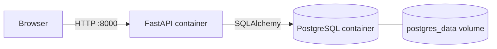
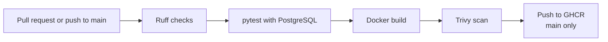

# URL Shortener

A URL shortener built with FastAPI and PostgreSQL.

The application itself is intentionally simple. The goal of this project is to learn backend development, databases, containers and CI, and to take the same application further step by step: deployment to Microsoft Azure, infrastructure as code and monitoring, and later Kubernetes.

## Features

- Create a short code for a long URL
- Redirect short URLs to the original URL
- Click counter for each short link
- Links stored in PostgreSQL and kept after restarts
- Simple frontend using HTML, CSS and Jinja2
- URL validation: only `http` and `https` URLs are accepted
- Clear error responses: `404` for unknown short codes and `422` for invalid URLs
- Retries automatically if a generated short code is already taken
- `/health` endpoint to check that the application is running
- `/ready` endpoint to check that the application can reach the database
- Application logging

## How it is built

- **Docker:** slim Python image running as a non-root user
- **Docker Compose:** runs the application and PostgreSQL together locally
- **Alembic:** database schema changes are managed through versioned migrations
- **pytest:** automated tests run against a separate PostgreSQL test database
- **Ruff:** checks the Python code and formatting
- **GitHub Actions:** CI runs on pull requests and pushes to `main`
- **Trivy:** scans the Docker image for known vulnerabilities
- **GitHub Container Registry:** successful images from `main` are published to GHCR

## Architecture

Current local setup:



CI pipeline:



## Tech Stack

| Area | Tools |
|---|---|
| Backend | Python, FastAPI, Uvicorn |
| Database | PostgreSQL, SQLAlchemy, Alembic |
| Frontend | HTML, CSS, Jinja2 |
| Containers | Docker, Docker Compose |
| Testing and quality | pytest, Ruff |
| CI and security | GitHub Actions, Trivy, GitHub Container Registry |

## Running locally

Requirements: Docker with Docker Compose.

```bash
git clone https://github.com/aden-farah/url-shortener-cicd.git
cd url-shortener-cicd
cp .env.example .env
docker compose up -d --build
```

Open:

```text
http://localhost:8000
```

Docker Compose reads the database credentials from a `.env` file, which is not committed. `.env.example` lists the required variables with development-only placeholder values. The application reads its database connection from the `DATABASE_URL` environment variable and does not start if it is missing.
## Running the tests

The tests need Python 3.12 and the PostgreSQL container from Docker Compose.

```bash
python3 -m venv .venv
source .venv/bin/activate
pip install -r requirements-dev.txt

docker compose up -d db
docker exec url-shortener-db createdb -U postgres url_shortener_test

python -m pytest -v
```

The tests use a separate database called `url_shortener_test`, so they do not touch the local development data.

## CI Pipeline

Pull requests and pushes to `main` run:

1. **Ruff** checks the code and formatting
2. **pytest** runs the tests against PostgreSQL
3. **Docker** builds the application image
4. **Trivy** scans the image for high and critical vulnerabilities

On pushes to `main`, the image that passed these checks is published to GitHub Container Registry and tagged with the commit SHA and `latest`.
Pull requests cannot be merged into `main` unless the CI pipeline passes.

## API

| Method | Path | Description |
|---|---|---|
| `GET` | `/` | Web interface |
| `GET` | `/health` | Returns `200` if the application is running |
| `GET` | `/ready` | Returns `200` if the database is reachable, `503` if not |
| `POST` | `/shorten` | Creates a short URL |
| `GET` | `/{short_code}` | Redirects to the original URL, or returns `404` if it does not exist |

## Project Structure

```text
url-shortener-cicd/
├── app/                  # FastAPI application
│   ├── main.py           # Routes and application logic
│   ├── config.py         # Settings from environment variables
│   ├── db.py             # Database connection and sessions
│   ├── models.py         # SQLAlchemy model
│   ├── templates/        # HTML template
│   └── static/           # CSS and JavaScript
├── migrations/           # Alembic migrations
├── tests/                # pytest tests
├── .github/workflows/    # CI pipeline
├── Dockerfile
├── compose.yml
├── requirements.txt      # Application dependencies
└── requirements-dev.txt  # Development and test dependencies
```

## Project Status

🚧 **Work in progress**

The application works locally and CI is in place. Cloud deployment and continuous deployment are not implemented yet.

### Roadmap

Planned next:

- Deploy the application to Microsoft Azure using Azure Container Apps
- Use Terraform to create the Azure infrastructure
- Use Azure Database for PostgreSQL for the production database
- Add continuous deployment from GitHub Actions to Azure using OpenID Connect
- Handle production secrets and configuration properly
- Add monitoring with Azure Monitor and Application Insights
- Add HTTPS-aware URL handling and rate limiting before making the application public

Later, after learning Kubernetes properly, I want to use this project to learn Azure Kubernetes Service (AKS).

## Why I Built This

I started this project to get more hands-on experience with how a backend application works together with a database and Docker.

I also wanted to build something that I could later take further with cloud deployment, CI/CD and monitoring instead of only running it locally.